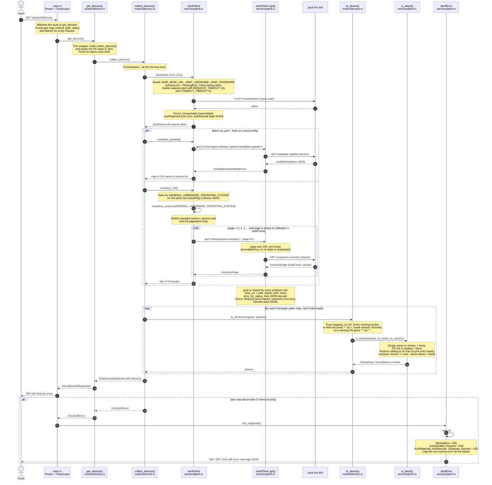

# Technical Architecture — `GET /api/jamf/devices`

Every function call one request makes, from the router to Jamf and back. Each note says
what that function does. The table under the chart has the same detail with file links.

## Function reference

| Function | File | What it does | Can fail with |
|---|---|---|---|
| `main()` router + `TraceLayer` | [src/main.rs](../src/main.rs) | Routes `GET /api/jamf/devices` to `get_devices`; logs method, path, status and latency per request. | — |
| `get_devices()` | [src/routes/devices.rs](../src/routes/devices.rs) | Calls `collect_devices()` and wraps the result in `Json`. Chooses no status code. | passes through `JamfError` |
| `collect_devices()` | [src/routes/devices.rs](../src/routes/devices.rs) | Builds the client, fetches the update catalog and the inventory at the same time with `tokio::try_join!`, then maps each computer to a `Device`. No re-sort. | passes through `JamfError` |
| `JamfClient::from_env()` | [src/services/jamf.rs](../src/services/jamf.rs) | Reads the three env vars, builds a `reqwest::Client` with request/connect timeouts, and swaps basic auth for a bearer token via `POST /v1/auth/token`. | `MissingEnv`, `Unreachable`, `AuthRejected`, `AuthDecode` |
| `available_updates()` | [src/services/jamf.rs](../src/services/jamf.rs) | `GET /v1/managed-software-updates/available-updates`; returns OS name → list of available versions (unsorted). | `Request`, `Upstream`, `Decode` |
| `inventory_full()` | [src/services/jamf.rs](../src/services/jamf.rs) | Calls `inventory_sections` with `GENERAL`, `HARDWARE`, `OPERATING_SYSTEM`. | `Request`, `Upstream`, `Decode` |
| `inventory_sections()` | [src/services/jamf.rs](../src/services/jamf.rs) | Builds the repeated `section=` params and pages through `GET /v4/computers-inventory` (100 per page, `sort=id:asc`) until a page is empty or `totalCount` is reached. | `Request`, `Upstream`, `Decode` |
| `get<T>()` | [src/services/jamf.rs](../src/services/jamf.rs) | Shared GET: joins base URL and path, adds bearer auth, sends, checks status, decodes JSON into `T`. | `Request` (send), `Upstream` (non-2xx), `Decode` (bad JSON) |
| `to_device()` | [src/routes/devices.rs](../src/routes/devices.rs) | Pure mapping of one `Computer` to a `Device`: missing fields become `""`, `os` is `"name version"` trimmed, `os_is_latest` from `is_latest`. | never fails |
| `is_latest()` | [src/services/jamf.rs](../src/services/jamf.rs) | `Some(true)` if the version is at least the catalog max for that OS, `Some(false)` if behind, `None` if it can't compare (no OS, OS not in catalog, empty list, unparseable version). | never fails, never panics |
| `JamfError::into_response()` / `status()` | [src/services/jamf.rs](../src/services/jamf.rs) | Picks the status (500 / 504 / 502), logs one `tracing::error!`, and returns `{"error": "..."}`. | — |
